# The Good Garden — Vertical Slice

A calm, Christian, Montessori-inspired learning adventure for ages 6–10, built in **Godot 4.3** with GDScript. This repository holds the **vertical slice** described in [`docs/design/VERTICAL_SLICE.md`](docs/design/VERTICAL_SLICE.md). It proves the core loop: explore → notice a need → do a hands-on activity → see the world change → keep exploring.

Design direction lives in [`docs/design/`](docs/design) (start with `AGENT_START_HERE.md`). How the code is organised is in [`docs/ARCHITECTURE.md`](docs/ARCHITECTURE.md), and how to write new days, activities and dialogue is in [`docs/CONTENT_GUIDE.md`](docs/CONTENT_GUIDE.md).

## Running it

1. Install [Godot 4.3](https://godotengine.org/download/archive/4.3-stable/) (the standard build, not .NET).
2. Open `project.godot` in the editor and press **Play**, or run `godot --path .` from this folder.

The project uses the **GL Compatibility** renderer so it runs on modest tablets, older laptops and (later) the web.

### Controls

| | Mouse / touch | Keyboard | Gamepad |
|---|---|---|---|
| Walk | Tap or hold on the ground | WASD / arrows | Left stick / D-pad |
| Use / talk | Tap the thing (the child walks over), or tap the green prompt | E / Space / Enter | A |
| Move pieces in an activity | Drag | Mouse | Left stick moves a hand cursor, **X** grabs/drops (keyboard: arrows + **G**) |
| Journal / Map / Pause | Buttons, top right | J / M / Esc | Y / Back / Start |

The camera follows on its own; the child never has to steer it.

## What's in the slice

| Required (VERTICAL_SLICE.md) | Where |
|---|---|
| Begin at Home, receive Miriam's Invitation | Letter on the stand by the cottage door (`home_region.gd`, `content/invitations/`) |
| Walk to the Garden, talk with Miriam | `garden_region.gd`, `content/dialogue/miriam.json` |
| Gardening activity: seed spacing + counting with self-correction | `content/activities/garden_bean_row.json` (spacing stick → three seeds per hole) |
| Planted bed persists and grows | `garden.bed_1` world fact; sprouts on day 2, seedlings on day 3, climbing plants after |
| Practical-life activity reusing the framework | `content/activities/home_set_table.json` (placemat outlines) |
| Chapel/Atrium with a Scripture material | `chapel_region.gd`, `content/activities/good_samaritan.json` (listen, wonder, retell, put away; never scored) |
| Chapel feels different | World "chapel" mood: dimmer warm light, a separate synthesized soundscape, quieter HUD, tabletop framing |
| Journal / Invitation flow | Journal records letters, the child's work, and optional real-world invitations |
| Save, quit, reload | Versioned save (`SaveService`), restored world facts, journal, discoveries and position |
| Village path, ambient villagers and animals, Bellhaven in the distance | `village_region.gd`, `valley_region.gd`, `bellhaven_vista.gd` (see it from the overlook north of the village) |

Also included: rest-until-morning day advance, an illustrated map that offers travel only to discovered places, settings (text size, read-aloud, less motion, easier dragging, volumes), and a gated grown-ups page with plain-language observations (never grades, never inferences about faith).

## Tests and checks

```sh
# Unit tests plus an end-to-end playthrough of the required flow
godot --headless --path . res://tests/test_runner.tscn

# Content validation only (ids, references, effect tokens, speakers, asset manifest)
godot --headless --path . res://tools/validate_content.tscn
```

Run `godot --headless --path . --editor --quit` once first on a fresh clone so Godot builds its class cache. Both commands exit non-zero on failure. Expect one `ERROR: SaveService: save is from a newer version (99)` line in the test output: that test checks that future saves are refused.

To render review screenshots (needs a display or Xvfb):

```sh
xvfb-run godot --path . --rendering-driver opengl3 --resolution 1280x720 \
  res://tools/screenshot_tour.tscn -- --out=/absolute/output/dir
```

## Assets

Art is mid-transition from placeholder to final:

- **KayKit (CC0)** models dress the built world: village buildings, mills, fields, fences, everyday props, cottage and Atrium furniture, tableware, and the distant Bellhaven skyline. They're a subset of three packs by Kay Lousberg.
- **Quaternius Stylized Nature MegaKit (CC0, free Standard edition)** provides the greenery: trees, pines, twisted landmark trees, bushes, ferns, grass, flowers, mushrooms, rocks and stepping stones. Large textures are downscaled to 1024 px for tablets, and foliage gets a palette tint (`tint` in `assets/props.json`).
- **Blending and lushness:** a shared storybook shader set lights every source the same way and grades each pack toward one palette. Procedural buildings, paths and soil get painted world-space patterns. Dense instanced meadows (grass, clover, wildflowers) grow everywhere except floors and paths, and leaves, grass and the river move gently unless "Less motion" is on. "Less scenery detail" in Settings thins the meadows for older tablets.
- Every imported file is listed in `assets/third_party/manifest.json` and summarized in `docs/design/THIRD_PARTY_ASSETS.md`.
- `assets/props.json` normalizes every imported model (scale to metres, pivot, collision). Regions place props by name with `Props.place()`, so swapping a model is a data change.
- **Still custom or procedural** (the identity pieces ART_DIRECTION.md says should be custom): the cottage shell, Chapel and Atrium shelves, the child's raised beds, the characters, the activity boards and UI art, and all sound.

The content validator fails if any file under `assets/third_party/` is missing from the manifest, or if a catalogued prop's model is missing.

## Review status

The Good Samaritan retelling and wondering questions are an **original draft** written for this prototype (`review_status` in the JSON). Scripture wording, curriculum and child-safety choices need qualified theological, educational and privacy review before any release, as the design docs require.

## Screenshots

Rendered with the software renderer by `tools/screenshot_tour.tscn`. Art pass: KayKit props and Quaternius greenery; characters and identity buildings are still placeholder.

| The stone bridge and the waterfall |
|---|
| 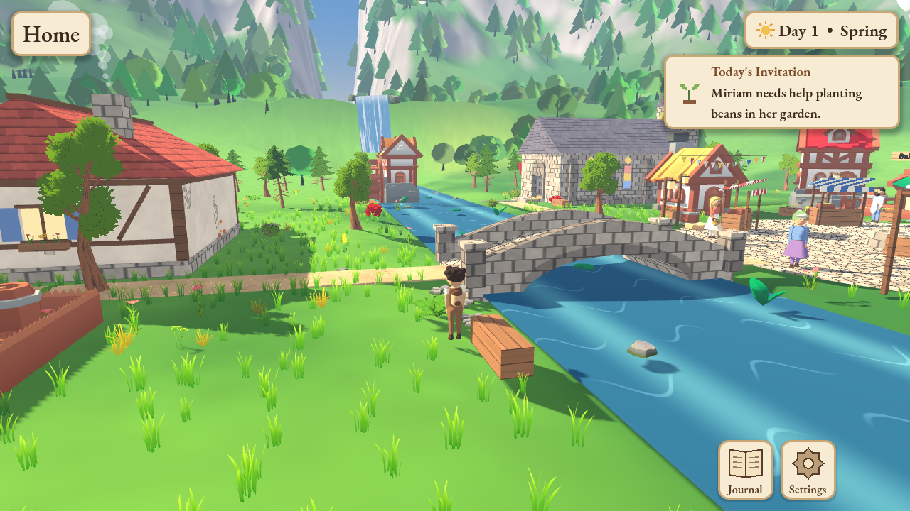 |

| Miriam's garden | Spacing the bean row | Bellhaven from the overlook |
|---|---|---|
| 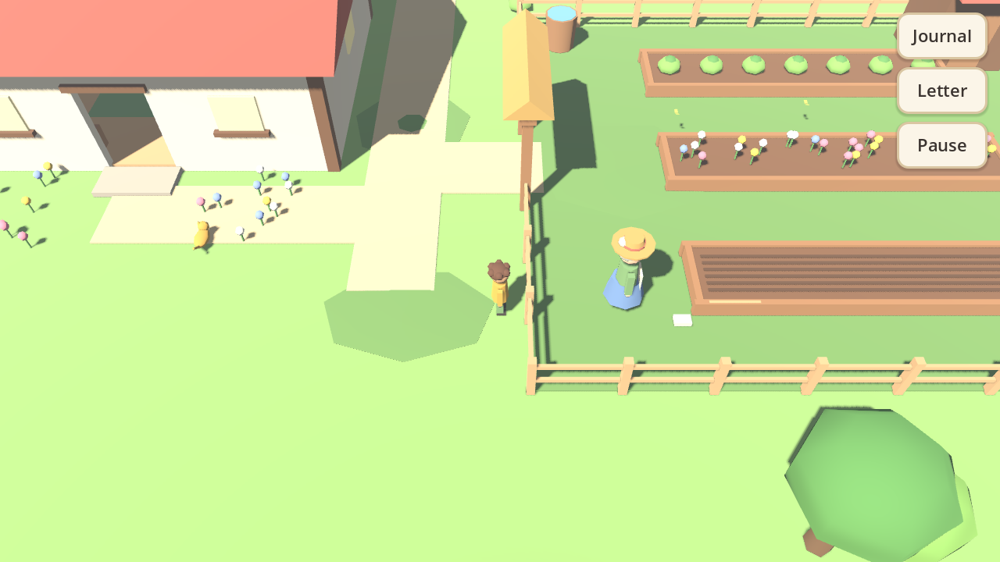 | 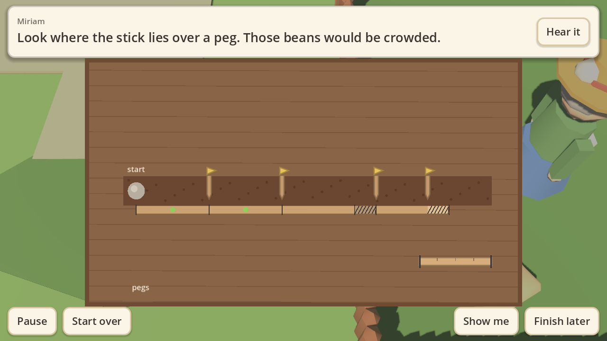 | 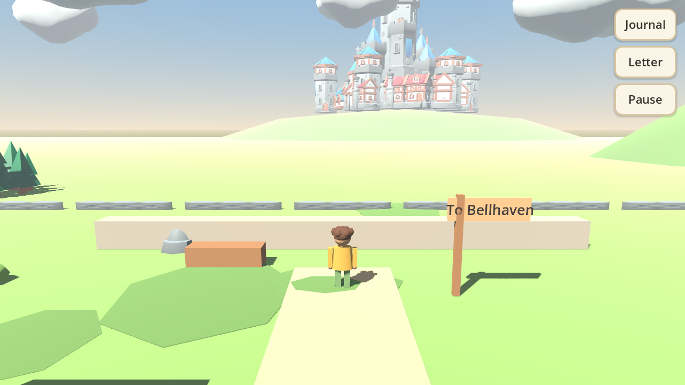 |

| The Good Samaritan (Atrium) | Day 2: the beans have sprouted |
|---|---|
| 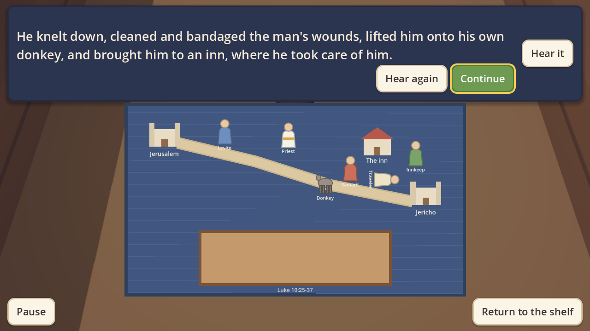 | 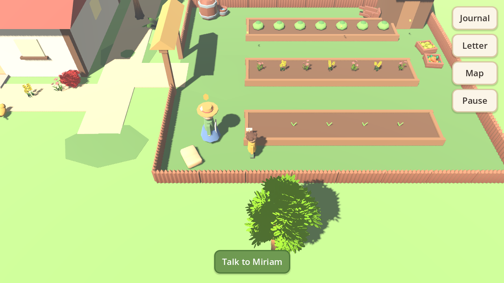 |

| The cast | Mid-stride (smooth skinned bodies) |
|---|---|
| 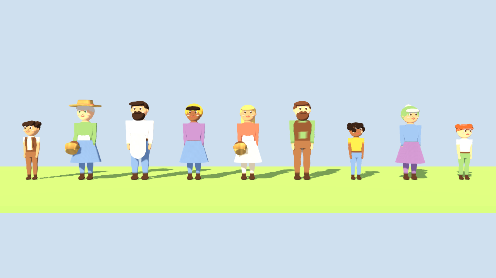 | 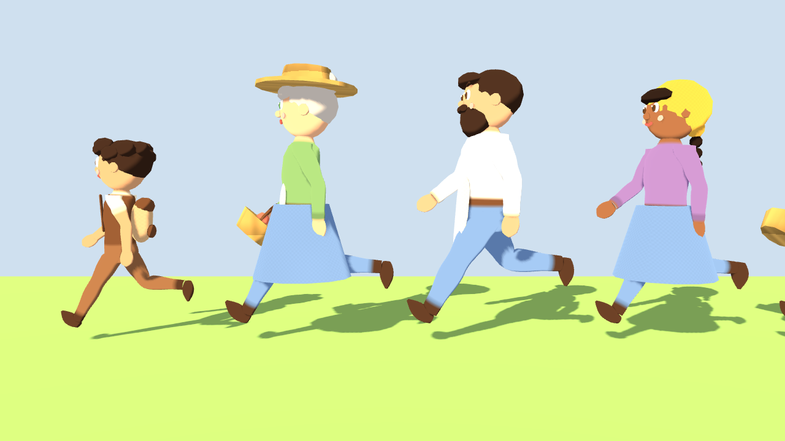 |

| The child and Miriam | Neighbours at the fountain |
|---|---|
| 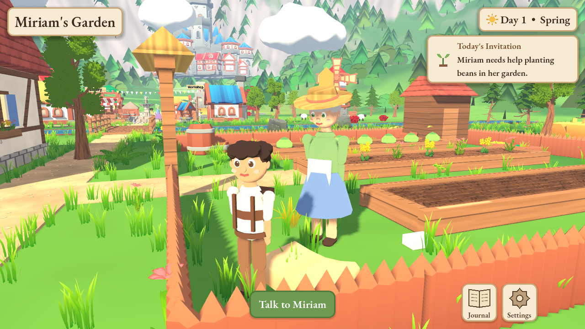 | 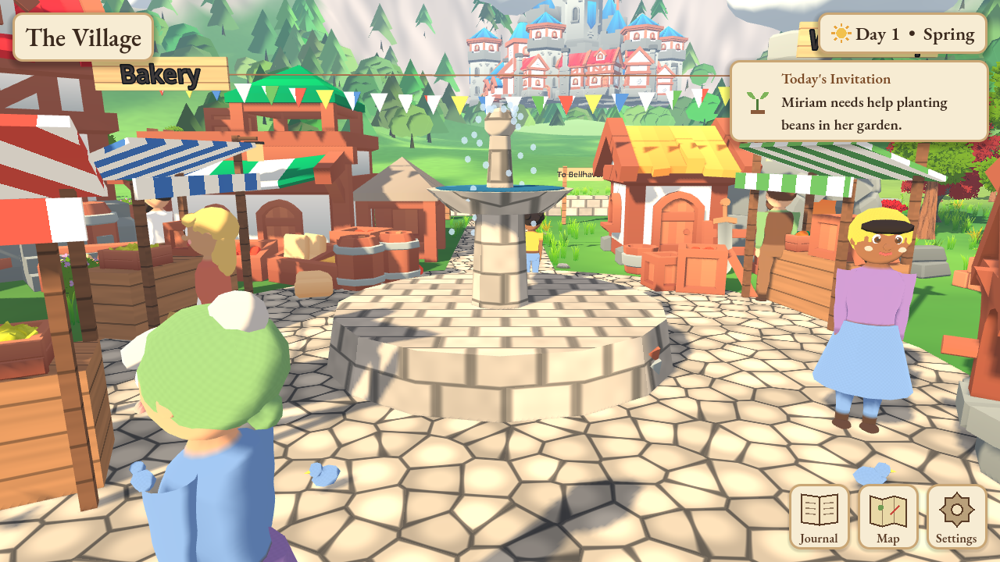 |

| Talking with Miriam | The village |
|---|---|
| 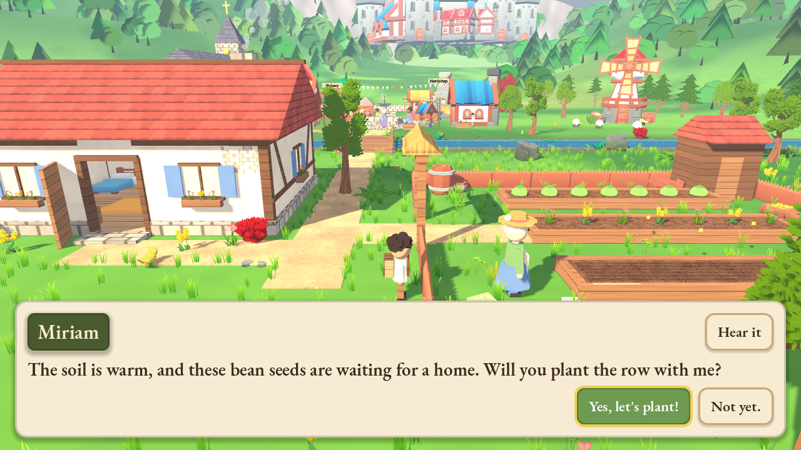 | 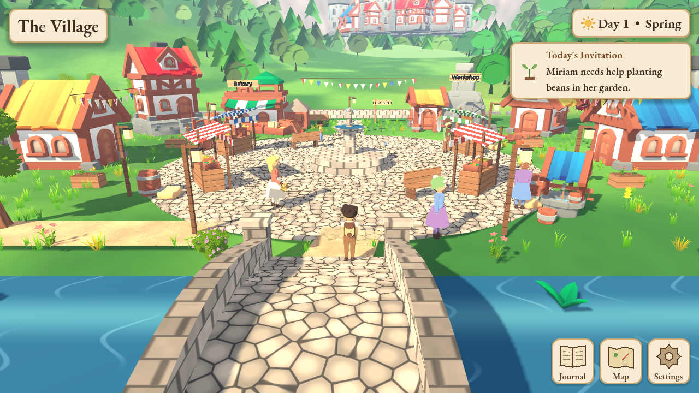 |

| The cottage | The chapel |
|---|---|
| 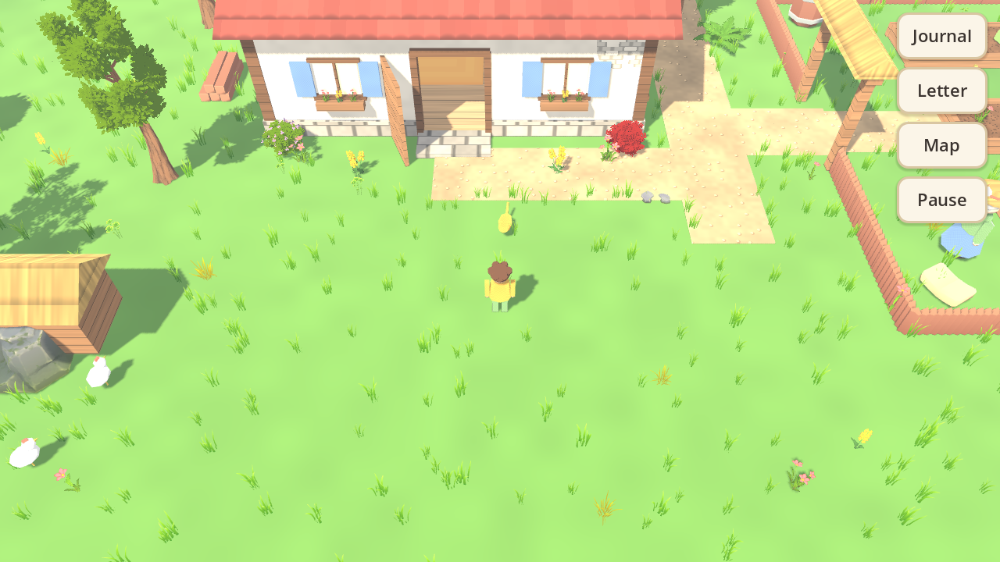 | 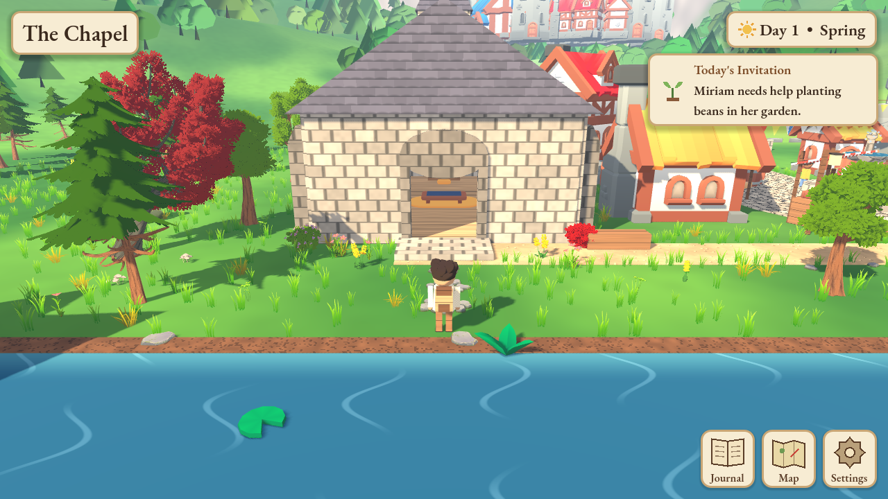 |
